<div align="center">
  <picture>
    <source media="(prefers-color-scheme: dark)" srcset="public/hades-logo-dark.svg" />
    
  </picture>
  <h1>Hades Gym Manager</h1>
  <p><b>Socios, planes, clases, reservas y cobro de cuotas de un gimnasio, en una sola aplicación web.</b></p>
  <p>
    <a href="https://dsw-frontend-sand.vercel.app">Demo</a> ·
    <a href="https://github.com/Vuadens/DSW-Backend">Backend</a> ·
    <a href="https://github.com/Vuadens/Hades-Gym-Manager/blob/main/proposal.md">Propuesta</a>
  </p>
  <a href="https://react.dev"></a>
  <a href="https://www.typescriptlang.org"></a>
  <a href="https://vite.dev"></a>
  <a href="https://github.com/Vuadens/DSW-Frontend/commits"></a>
  <a href="https://github.com/Vuadens/DSW-Frontend/pulls?q=is%3Apr+is%3Aclosed"></a>
</div>

<br />

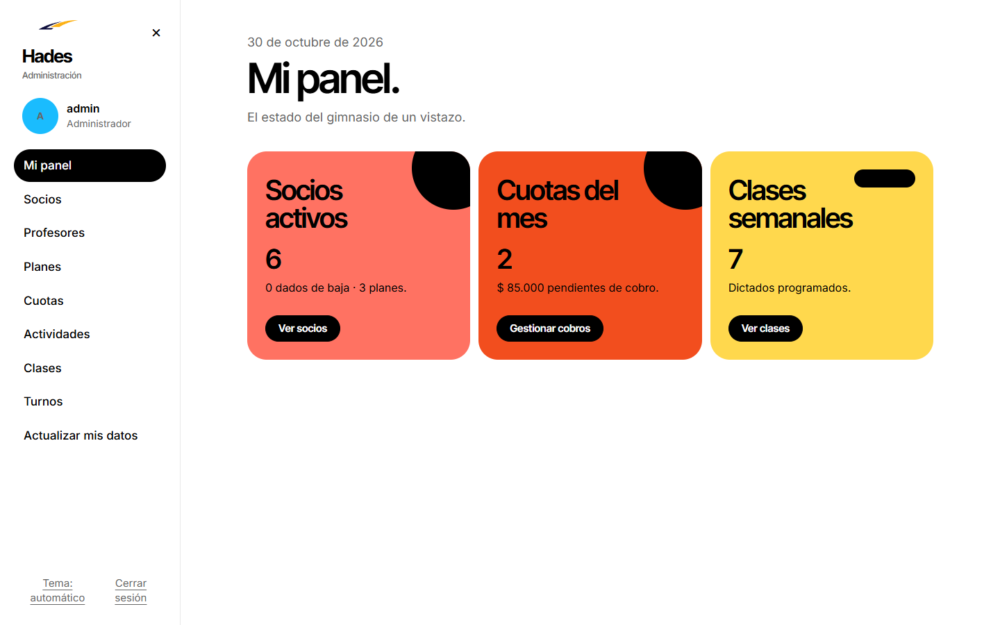

## Contenido

- [Sobre el proyecto](#sobre-el-proyecto)
- [Cómo lo desarrollamos](#cómo-lo-desarrollamos)
- [Funcionalidades](#funcionalidades)
- [Capturas](#capturas)
- [Instalación desde cero](#instalación-desde-cero)
- [Modos de ejecución](#modos-de-ejecución)
- [Cuentas de prueba](#cuentas-de-prueba)
- [Scripts](#scripts)
- [Estructura](#estructura)
- [Solución de problemas](#solución-de-problemas)
- [Equipo](#equipo)

## Sobre el proyecto

Hades es nuestro trabajo práctico de **Desarrollo de Software** en la UTN Facultad Regional Rosario. La [consigna](https://github.com/Vuadens/Hades-Gym-Manager) nos pedía una aplicación full stack con frontend y backend independientes, comunicados por una API. Elegimos un problema concreto: centralizar la administración de un gimnasio, con control de cupos, cuotas y actividades.

En este repositorio está el frontend. La API, la base de datos y el modelo de dominio están en [DSW-Backend](https://github.com/Vuadens/DSW-Backend).

## Cómo lo desarrollamos

**Empezamos por la experiencia de cada rol.** Armamos primero los flujos de administrador, profesor y socio con datos en memoria. Así definimos las pantallas antes de conectarlas, y de ese trabajo surgió el modo demo que todavía mantenemos.

**Conectamos el backend por partes.** Escribimos una especificación con las decisiones del equipo y la dividimos en una pull request por bloque: login, socios y profesores, actividades y turnos, clases e inscripciones, y listados. Arrancamos por el login porque sin él no podíamos conectar nada más.

**Preferimos ocultar antes que simular.** En modo conectado, un módulo sin backend no se muestra. Así, todo lo que aparece en pantalla trabaja con datos reales.

**El backend tiene la última palabra.** El frontend anticipa las reglas de reserva para responder al instante, pero las valida la API. Si una regla cambia o alguien saltea la interfaz, la API sigue rechazando lo que no corresponde.

**Ajustamos el frontend al modelo de dominio.** Cuando socios y profesores pasaron a heredar de Persona, actualizamos modelos, servicios y formularios, y quitamos los campos que ya no existían.

**Cerramos el alcance de regularidad.** Por último sumamos el cobro de cuotas, el CRUD de planes y el detalle de socios y clases con datos pedidos al backend.

## Funcionalidades

| Rol | Qué puede hacer |
|---|---|
| **Administrador** | Gestionar socios, profesores, planes, actividades, clases y turnos. Inscribir socios, registrar cobros y consultar lo cobrado y adeudado por mes. |
| **Profesor** | Ver su agenda, actualizar sus datos y consultar los socios de cada plan, sin acceder al estado de sus cuotas. |
| **Socio** | Reservar y cancelar clases, y consultar sus reservas, sus cuotas y sus datos. |

Además, incorporamos:

- Inicio de sesión con email o DNI, y sesión recuperada al recargar la página.
- Contraseña inicial con cambio obligatorio en el primer ingreso.
- Reservas validadas por cupo, plan y estado de la cuota.
- Listados filtrables por día o por plan, con detalle obtenido del backend.
- Tema claro, oscuro o automático.
- Diseño adaptable a celular, tablet y escritorio.

## Capturas

<table>
  <tr>
    <td><b>Página de inicio</b></td>
    <td><b>Inicio del socio</b></td>
  </tr>
  <tr>
    <td>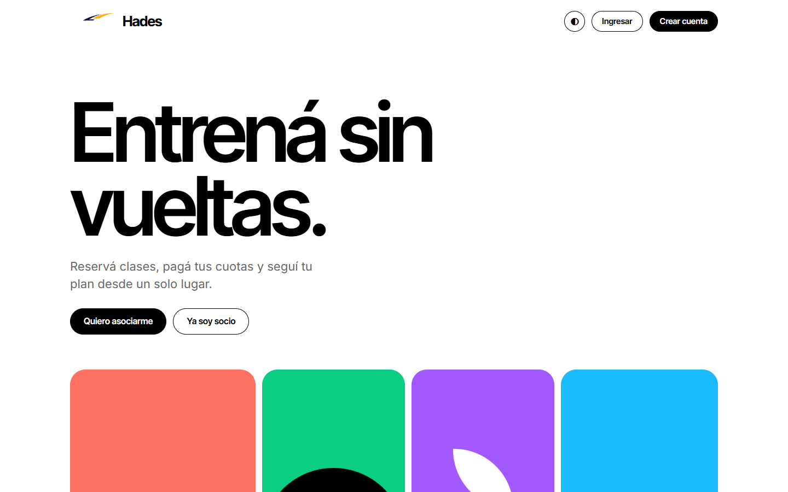</td>
    <td>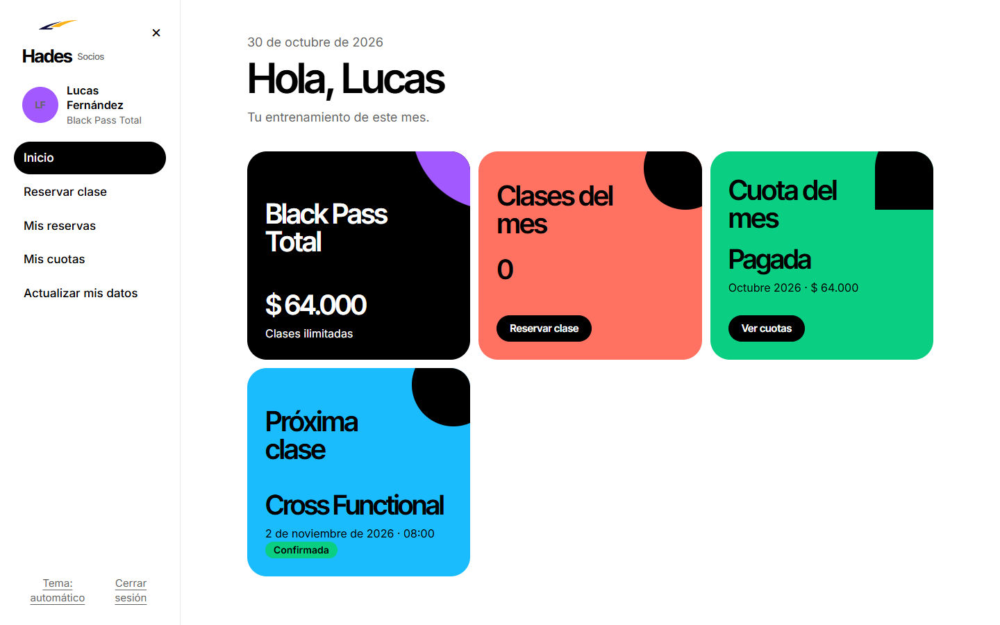</td>
  </tr>
  <tr>
    <td><b>Socios filtrados por plan</b></td>
    <td><b>Detalle del socio</b></td>
  </tr>
  <tr>
    <td>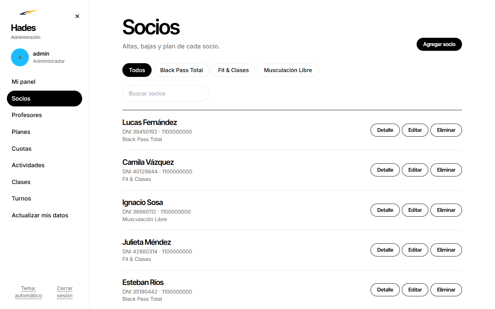</td>
    <td>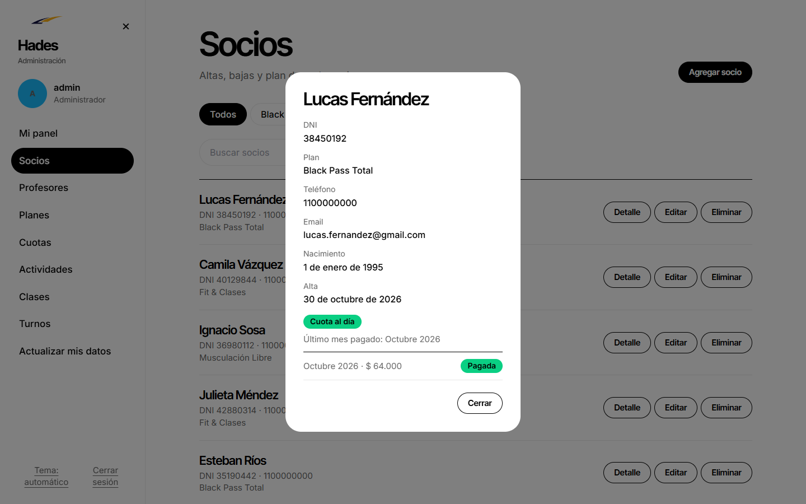</td>
  </tr>
  <tr>
    <td><b>Clases filtradas por día</b></td>
    <td><b>Detalle de la clase</b></td>
  </tr>
  <tr>
    <td>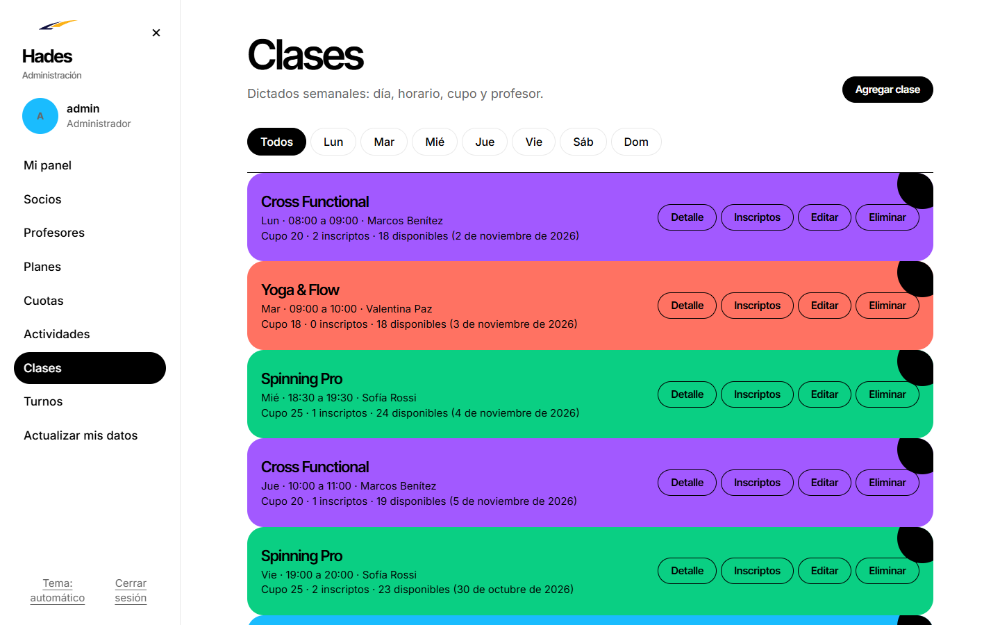</td>
    <td>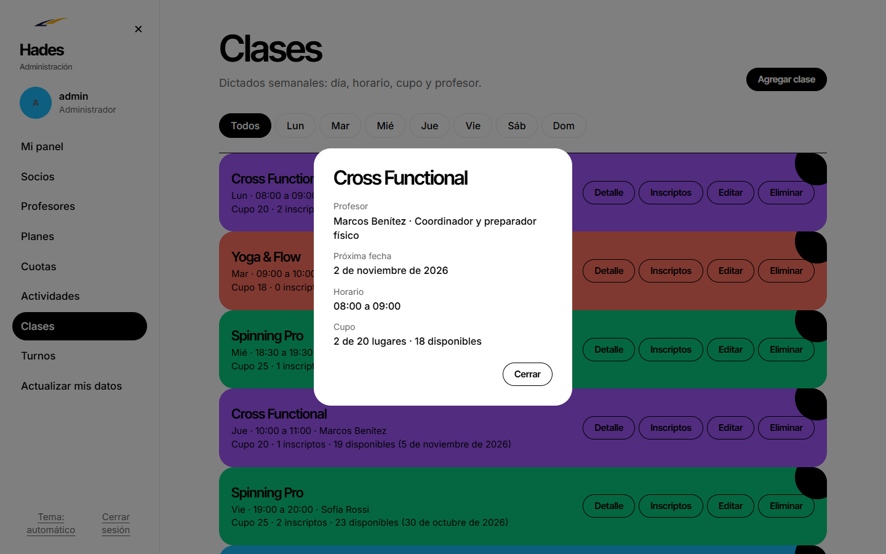</td>
  </tr>
  <tr>
    <td><b>Cobro de cuotas</b></td>
    <td><b>Planes</b></td>
  </tr>
  <tr>
    <td>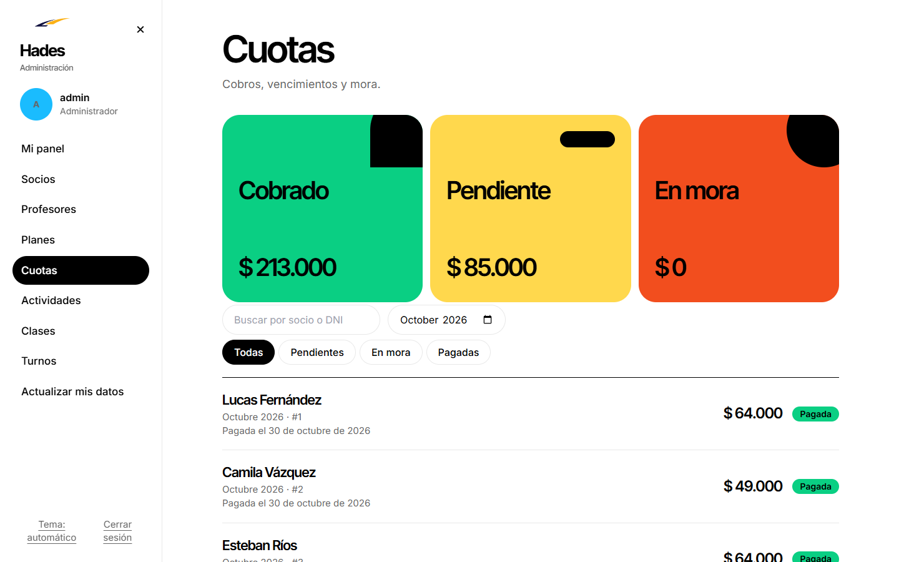</td>
    <td>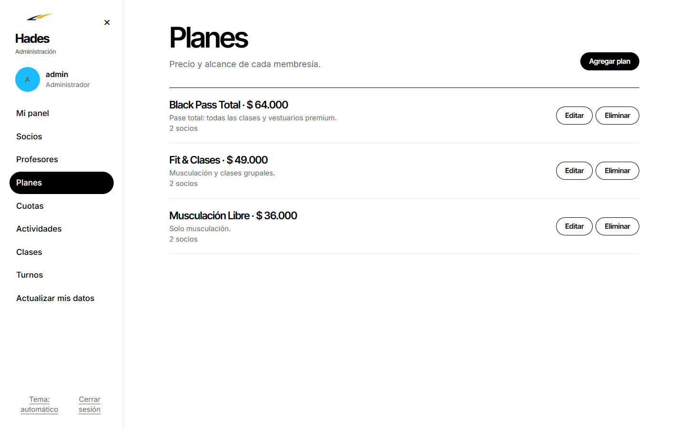</td>
  </tr>
  <tr>
    <td><b>Reserva de clases</b></td>
    <td><b>Socios por plan, vista del profesor</b></td>
  </tr>
  <tr>
    <td>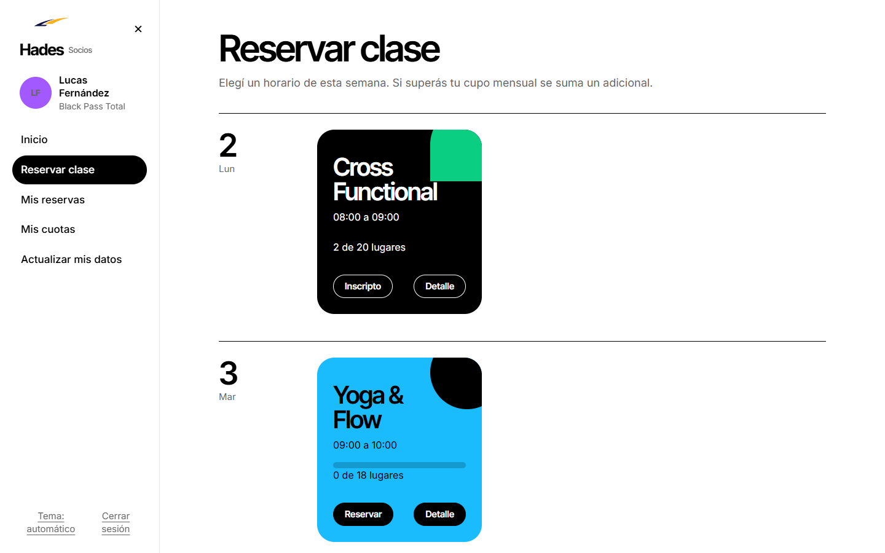</td>
    <td>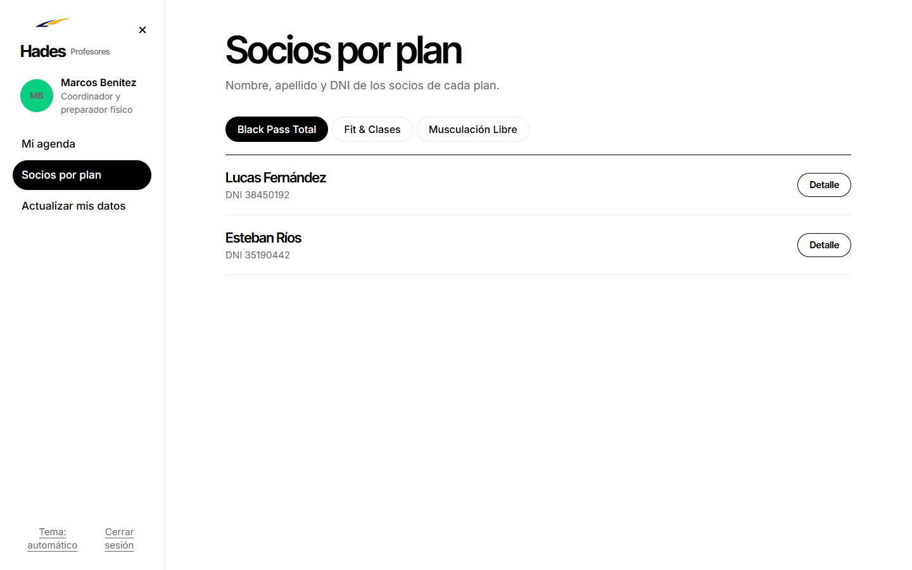</td>
  </tr>
  <tr>
    <td><b>Tema oscuro</b></td>
    <td><b>Celular</b></td>
  </tr>
  <tr>
    <td>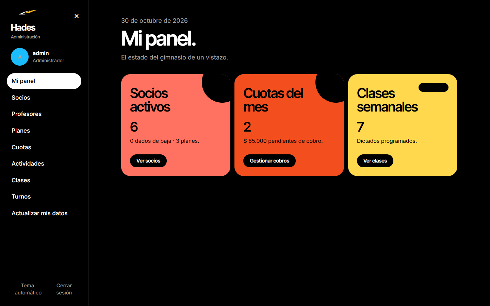</td>
    <td align="center">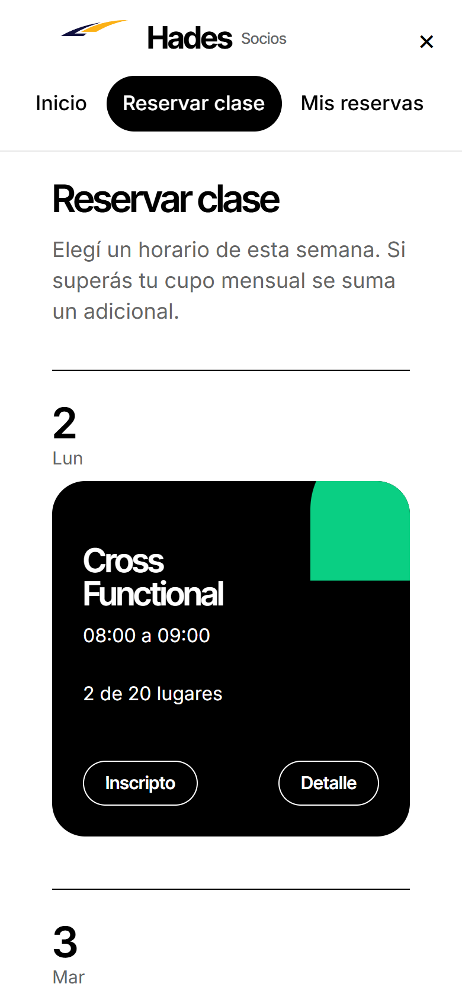</td>
  </tr>
</table>

## Instalación desde cero

### Requisitos

- [Node.js](https://nodejs.org). Lo probamos con la versión 24.
- [pnpm](https://pnpm.io): `npm install -g pnpm`
- [Git](https://git-scm.com)
- [DSW-Backend](https://github.com/Vuadens/DSW-Backend) corriendo, si vas a usar el modo conectado.

### Pasos

1. Levantá el backend siguiendo [su guía de instalación](https://github.com/Vuadens/DSW-Backend#instalación-desde-cero).

2. Cloná este repositorio e instalá las dependencias:

   ```bash
   git clone https://github.com/Vuadens/DSW-Frontend.git
   cd DSW-Frontend
   pnpm install
   ```

3. Creá el archivo de entorno:

   ```bash
   cp .env.example .env
   ```

4. Indicá la URL del backend en `.env`, sin `/api` al final. Tiene que coincidir con el `PORT` del backend:

   ```env
   VITE_API_URL=http://localhost:3000
   ```

5. Iniciá la aplicación:

   ```bash
   pnpm dev
   ```

6. Abrí `http://localhost:5173`.

Para probar la interfaz sin backend, dejá `VITE_API_URL=` vacío en el paso 4 y omití el paso 1.

## Modos de ejecución

Mantuvimos dos modos para poder mostrar la interfaz completa sin instalar nada y, a la vez, trabajar contra el sistema real. `VITE_API_URL` define el modo al iniciar o compilar la aplicación. Después de cambiarla, reiniciá `pnpm dev`.

| | Demo | Conectado |
|---|---|---|
| **`VITE_API_URL`** | Vacía | URL del backend |
| **Datos** | En memoria; se pierden al recargar | Los de la base, por medio de la API |
| **Inicio de sesión** | Local | JWT; un error 401 cierra la sesión |
| **Fecha actual** | Fija en 11 de octubre de 2026 | La real |
| **Módulos sin backend** | Finanzas, máquinas, materiales, recuperar clave, foto de perfil, sueldos y clases por período | Ocultos |

La [demo publicada](https://dsw-frontend-sand.vercel.app) corre en modo demo.

## Cuentas de prueba

**Modo demo**

| Rol | Email | Contraseña |
|---|---|---|
| Administrador | `admin@hadesgym.com` | `admin123` |
| Profesor | `marcos.benitez@hadesgym.com` | `profe123` |
| Socio | `lucas.fernandez@gmail.com` | `socio123` |

**Modo conectado**

Las cuentas son las del seed del backend, con la contraseña `DEMO_PASSWORD`, que por defecto es `demo1234`. El administrador usa `ADMIN_EMAIL` y `ADMIN_PASSWORD`.

| Rol | Email | DNI |
|---|---|---|
| Profesor | `marcos.benitez@hadesgym.com` | `28450111` |
| Socio al día | `lucas.fernandez@gmail.com` | `38450192` |
| Socio con cuota pendiente | `ignacio.sosa@outlook.com` | `36980112` |

## Scripts

| Comando | Descripción |
|---|---|
| `pnpm dev` | Servidor de desarrollo en `http://localhost:5173` |
| `pnpm build` | Verificación de tipos y compilación de producción |
| `pnpm preview` | Sirve la compilación de producción |
| `pnpm test` | Pruebas con Vitest. Todavía no escribimos pruebas |

## Estructura

```text
src/
├── api/          Cliente HTTP y servicios por recurso
├── components/   Componentes comunes y layout
├── data/         Datos del modo demo
├── hooks/        Hooks de datos
├── lib/          Formato, formularios y reglas de negocio
├── models/       Tipos del dominio
├── pages/        Pantallas por rol: admin, auth, profesor y socio
├── routes/       Rutas y acceso por rol
└── stores/       Estado global con Zustand
```

**Stack:** React, TypeScript, Vite, React Router, Zustand, React Hook Form, Zod y Axios.

## Solución de problemas

| Problema | Solución |
|---|---|
| `ENOENT` o `Could not read package.json` | Corré el comando dentro de `DSW-Frontend` |
| La app aparece en modo demo | Revisá `VITE_API_URL` y reiniciá `pnpm dev` |
| `No pudimos conectar con el servidor` | Confirmá que el backend esté activo y que el puerto coincida con `PORT` |
| Las cuentas de prueba no ingresan | Corré el seed del backend sobre una base sin planes |
| `Port 5173 is in use` | Cerrá el otro proceso o entrá a la URL que indica la terminal |

## Equipo

Desarrollamos Hades entre cuatro:

- Juan Manuel Hidalgo Alcain
- Joaquín Emiliano Maza
- Lucas Emiliano Blesi
- Julieta Romina Méndez
